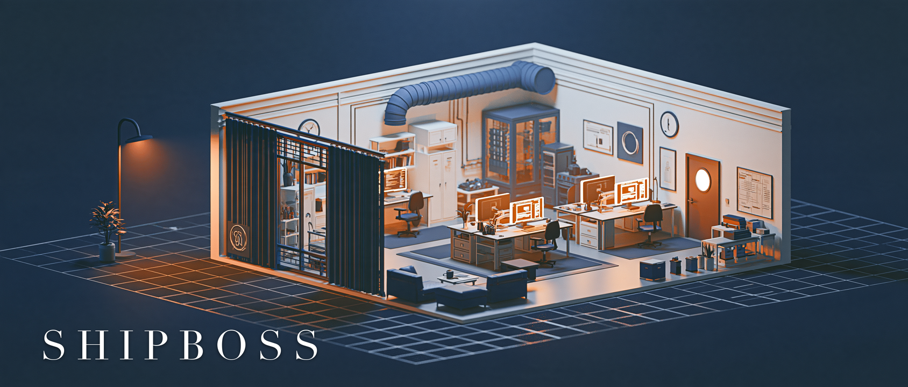

<p align="center">
  
</p>

<h1 align="center">SHIPBOSS</h1>

<p align="center"><strong>You're the boss. You only need one PM.</strong></p>

<p align="center">
  <a href="https://github.com/Lechoung-J/SHIPBOSS/releases"></a>
  <a href="LICENSE"></a>
  
  
</p>

<p align="center">
  <a href="README.md"><strong>English</strong></a> · <a href="README.zh-CN.md">中文</a>
</p>

---

## Your job shouldn't be "watching the AI work"

You hired an AI to write code. Somehow you got busier:

- You check where it is every ten minutes
- It says "done" — so you open a 3,000-line diff and read it yourself
- It says "tests pass" — so you run them again anyway
- It stalls halfway, so you sit there waiting

**You hired an employee and ended up sitting in the chair yourself.**

---

## Two things everyone else is selling. We're not selling either.

**More tools.** Faster autocomplete, bigger models, prettier dashboards. The tools got better. You're still the one watching.

**An AI team.** Product manager, architect, frontend, backend, QA, DevOps — a whole org chart of roles. Feels great until you realize your management load went from zero people to twelve.

**SHIPBOSS gives you three.**

---

## A small team, and a boss

| Role | Who | What they do |
|---|---|---|
| **Boss** | You | Ideas, decisions, one page. **No status checks, no diffs.** |
| **PM** | Your agent | Turns an idea into a **spec-driven** task with checkable acceptance criteria, dispatches it, and tells you yes-or-no in plain language |
| **Engineer** | Another agent | Works in its own workspace, ships code and evidence |
| **Verifier** | A third one, brand new | Never saw the work, re-runs every check from scratch. Has no ego about rejecting it |

No org chart. New idea? Open a ticket. No idea? The team idles.

**Of these four, exactly one doesn't need to be present: you.**

---

## What it actually takes off your plate

It's not "write code faster." It's **delegation with a gate**:

| What you used to do yourself | Who does it now |
|---|---|
| Decide whether "done" means done | **Independent verification**: a fresh context re-runs the commands in a separate workspace and reports exit codes, not adjectives |
| Decide whether this can merge | PM checks every acceptance criterion and hands you PASS/FAIL with evidence |
| Figure out why it's stuck and what's next | PM writes it on one page, in the plainest language it can manage |

**What you receive isn't a report. It's a decision: ship or not.**

---

## Then close the laptop

Start the flow, tell the PM what you want, and walk away.

Make coffee. Take a delivery. Talk to a human.

When you come back, there's one page on the desk:

```
Verdict: PASS
Changed: three files, one line each
Verified: these two commands, exit code 0
Risk: this one thing wasn't tested, because …
Needs you: nothing
```

**The work didn't stop while you were gone. You just have to nod or shake your head.**

---

## Getting started

```bash
git clone https://github.com/Lechoung-J/SHIPBOSS.git
cd SHIPBOSS
bash verify.sh          # confirm the kit you just got is complete
```

Then hand these to your AI coding agent:

- [`PROTOCOL.md`](PROTOCOL.md) — how the four roles work together, what counts as done, and which behaviors are violations on sight
- [`platforms/`](platforms/) — how to dispatch on Claude Code, Codex, or DSH, what each host cannot do, and how to wait for completion
- Start your first ticket from [`references/spec-template.md`](references/spec-template.md). Every ticket needs an acceptance checklist — items you can tick, never "better UX"
- The seven `references/` templates are still Chinese-only; English versions come in a later release

> Optional: on the first session, your agent can print [`docs/welcome.txt`](docs/welcome.txt) once —
> the same banner the installer shows. One fenced code block, once per session.

> To be clear about what this is: **this repo ships the rules, not an installed product.**
> Hand the rules to your agent (or the skill for your platform) and *that* becomes your PM.

---

## What it is not

- **Not a smarter AI.** It doesn't improve the model; it makes vague handoffs fail.
- **Not another multi-agent orchestration framework.** Three roles, one page, one boss.
- **Not a new tool to learn.** Plain Markdown. No runtime, no account, no editor takeover.

---

## Who this is for

- **Solo builders driving Codex or Claude Code** — you're tired of the sentence "it's done."
- **Tech leads with two or three people** — you need an audit trail, and an answer to "why did this merge?"
- **Anyone building agent pipelines** — what's missing isn't scheduling, it's the step that says *no*.
- **People who want their day back** — you don't want to spend it supervising something that never gets tired.

---

## SHIPBOSS, in its own words

> I don't write code. I don't think for you.
> I do one thing: when someone says "it's done," I make them put the evidence on the table.
> Go do something else. I'm watching.

---

[English](README.md) | [中文](README.zh-CN.md) · MIT · Plain Markdown
