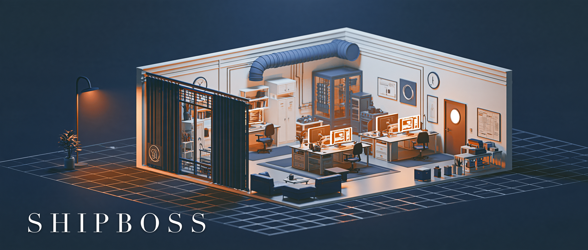
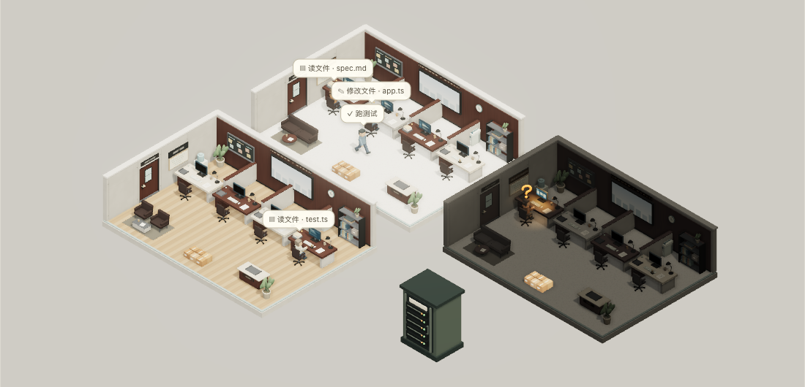

<p align="center">
  
</p>

<h1 align="center">SHIPBOSS</h1>

<p align="center"><strong>你是老板。你只需要一个产品经理。</strong></p>

<p align="center">
  <a href="https://github.com/Lechoung-J/SHIPBOSS/releases"></a>
  <a href="LICENSE"></a>
  
  
</p>

<p align="center">
  <a href="README.md">English</a> · <a href="README.zh-CN.md"><strong>中文</strong></a>
</p>

---

## 你今天的工作，不该是「看着 AI 干活」

请了 AI 帮你写代码，结果你更忙了：

- 你得盯着它跑到哪一步
- 它说「完成了」，你得打开 diff 一行行看
- 它说「测试过了」，你得自己再跑一遍
- 它中途卡住，你得一直在旁边等

【**你雇了个员工，结果自己坐进了工位。**】

---

你不必一直盯着，也能随时像玩策略游戏一样，看见每个 AI 员工在做什么。可选的本地观察窗把项目画成房间。PM 在整理任务，工程师在写代码，验收员在独立检查。角色旁的气泡显示读文件、修改或跑测试等状态。扫一眼，就知道该看哪里。



*演示画面：项目、任务和工具目标均为示例。*

## 市面上有两种方案，我们都不做

**第一种：更多工具。** 更快的补全、更强的模型、更花哨的面板。工具变强了，盯着它的人还是你。

**第二种：给你一个 AI 团队。** 产品经理、架构师、前端、后端、测试、运维……一长串角色，一张编制表。
看起来很爽，实际你要管理的组织从 0 个人变成了 12 个人。

【**SHIPBOSS 只给你三个人。**】

---

## 一个小团队，和一个老板

| 角色 | 谁 | 干什么 |
|---|---|---|
| **老板** | 你 | 出想法、拍板、看一页纸。**不盯进度，不读 diff。** |
| **产品经理** | 你的 agent | 把想法变成能验收的活、派给工程师、验收完用一句人话告诉你行不行 |
| **工程师** | 另一个 agent | 在一个独立工作区里干活，交代码，交证据 |
| **验收员** | 再一个，全新的 | 没见过这活，从头重跑一遍检查。它不心疼推翻 |

没有编制表。有新想法，就开一单；没有想法，团队就闲着。

【**关键在于：这四个人里，只有你不需要在场。**】

---

## 它到底替你把住了什么关

不是「帮你写得更快」，是**替你挡住三件最耗你的事**：

| 你以前必须亲自干 | 现在是谁在干 |
|---|---|
| 判断「它说完成了」到底完成没有 | **独立验收**：验收员在独立工作区重跑命令，拿退出码说话 |
| 判断这一版能不能合 | 产品经理逐条对照**可判定**的验收标准，给你 PASS/FAIL |
| 搞清楚它为什么卡住、下一步是什么 | 产品经理用**最直白的话**写一页纸汇报，不绕弯 |

【**你收到的不是报告，是一个决定：行，还是不行。**】

---

## 然后去做别的事

把想法告诉产品经理，让会话和运行环境保持运行。
你就可以先去做别的事。

去做杯咖啡。收个快递。跟同事聊两句。

回来时，桌上放着一页纸：

```
结论：PASS
改了什么：三个文件，一句话一个
怎么验的：这两个命令，退出码 0
风险：这一处没测过，原因是……
需要你决定：无
```

【**把执行交给团队，把有证据的决定留给自己。**】

---

## 怎么开始

```bash
git clone https://github.com/Lechoung-J/SHIPBOSS.git
cd SHIPBOSS
bash verify.sh          # 确认你拿到的这套东西是完整的
```

然后把这两份交给你的 agent：

- [`PROTOCOL.md`](PROTOCOL.zh-CN.md) —— 四个角色怎么协作、什么算「完事了」、哪些做法直接判违规
- [`platforms/`](platforms/) —— 你的 agent 怎么派活、怎么等、什么做不到
- 第一张单照着 [`references/spec-template.md`](references/spec-template.zh-CN.md) 这份**工单模板**抄；
  每张单都要有一张**验收清单**（逐条能打勾，不能写「体验更好」）
- 核心模板提供中英文本；按你的宿主选择对应说明。
- 可选观察窗的依赖、安装、升级和实际支持条件见[详细安装说明（English）](docs/observer-install.md)。

> 可选：首次会话里，agent 可以打印一次 [`docs/welcome.txt`](docs/welcome.txt)——
> 跟安装脚本显示的是同一块字。放进一个代码块，每个会话只打一次。

> **核心是一套可独立使用的 Markdown 协议。** 把协议或对应 Skill 交给 agent，它就按产品经理的职责工作。
> 想看团队状态，再按安装说明启用可选的本地 macOS 观察窗。

---

## 它不是什么

- **不是更聪明的 AI。** 它不提升模型能力，它只让含糊的交付过不去。
- **不是一堆角色的编排框架。** 三个人，一张纸，一个老板。
- **不是让你学一套新工具。** 核心协议用 Markdown 阅读即可。可选观察窗另需本地依赖，不接管编辑器。

---

## 谁该用它

- **一个人用 Codex / Claude Code 干活**：你已经烦透了「它说完成了」这句话。
- **带两三个人的技术负责人**：你需要留痕，需要能解释「这行为什么能合」。
- **想做点别的事的人**：你不想把一天耗在盯着一个不会累的东西干活上。
- **在搭 agent 流水线**：你缺的不是调度，是流水线上那个**说不行**的环节；缺一套能复用的 **agent 协作** 规矩。

---

## SHIPBOSS 自己说一句

> 我不写代码，也不替你思考。
> 我只做一件事：让「好了」这两个字，必须拿出证据才算数。
> 你去忙别的，这里有我盯着。

---

[English](README.md) | [中文](README.zh-CN.md) · MIT · Markdown 协议 + 可选观察窗
